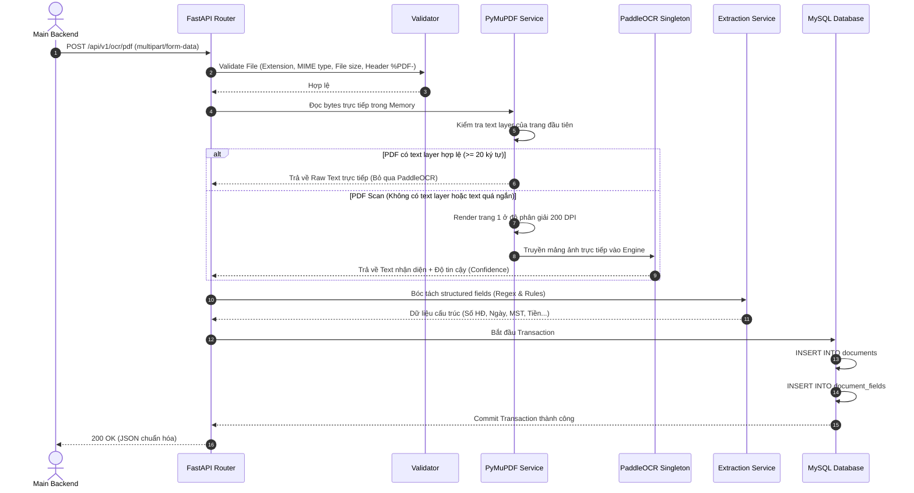

# TÀI LIỆU HƯỚNG DẪN SỬ DỤNG VÀ TÍCH HỢP OCR SERVICE

Tài liệu này cung cấp hướng dẫn toàn diện về cách cài đặt, vận hành, kiểm thử và tích hợp **OCR Service** (Service độc lập chuyên xử lý tài liệu PDF 1 trang nền trắng bằng cơ chế Hybrid Direct Text Extraction & PaddleOCR Fallback).

---

## MỤC LỤC
1. [Tổng Quan Hệ Thống](#1-tổng-quan-hệ-thống)
2. [Kiến Trúc & Luồng Xử Lý (Workflow)](#2-kiến-trúc--luồng-xử-lý-workflow)
   - [2.1. Tại Sao Ưu Tiên PyMuPDF Đọc Trực Tiếp Trước Khi Fallback Sang OCR?](#21-tại-sao-ưu-tiên-pymupdf-đọc-trực-tiếp-trước-khi-fallback-sang-ocr)
3. [Cấu Trúc Thư Mục Dự Án](#3-cấu-trúc-thư-mục-dự-án)
4. [Cấu Hình Biến Môi Trường (.env)](#4-cấu-hình-biến-môi-trường-env)
5. [Hướng Dẫn Triển Khai & Vận Hành](#5-hướng-dẫn-triển-khai--vận-hành)
   - [5.1. Triển khai bằng Docker Compose (Khuyên dùng)](#51-triển-khai-bằng-docker-compose-khuyên-dùng)
   - [5.2. Chạy Container độc lập](#52-chạy-container-độc-lập)
   - [5.3. Chạy môi trường Local (Phát triển)](#53-chạy-môi-trường-local-phát-triển)
6. [Đặc Tả REST API & Tích Hợp](#6-đặc-tả-rest-api--tích-hợp)
   - [6.1. Endpoint Health Check (`GET /health`)](#61-endpoint-health-check-get-health)
   - [6.2. Endpoint Upload & OCR PDF (`POST /api/v1/ocr/pdf`)](#62-endpoint-upload--ocr-pdf-post-apiv1ocrpdf)
7. [Mã Nguồn Ví Dụ Cho Backend Gọi OCR Service](#7-mã-nguồn-ví-dụ-cho-backend-gọi-ocr-service)
   - [7.1. Python (requests)](#71-python-requests)
   - [7.2. Node.js (axios / form-data)](#72-nodejs-axios--form-data)
   - [7.3. cURL CLI](#73-curl-cli)
8. [Cơ Sở Dữ Liệu & Giao Dịch (Database Schema)](#8-cơ-sở-dữ-liệu--giao-dịch-database-schema)
9. [Đóng Gói & Đẩy Lên Docker Registry](#9-đóng-gói--đẩy-lên-docker-registry)
10. [Kiểm Thử Tự Động (Testing)](#10-kiểm-thử-tự-động-testing)
11. [Xử Lý Sự Cố Thường Gặp (Troubleshooting)](#11-xử-lý-sự-cố-thường-gặp-troubleshooting)

---

## 1. Tổng Quan Hệ Thống

**OCR Service** là một microservice độc lập với nghiệp vụ cốt lõi:
- **Đầu vào**: File PDF 1 trang (hóa đơn, chứng từ, biên bản, văn bản hành chính...).
- **Xử lý Hybrid**:
  1. Thử trích xuất text trực tiếp từ text layer của PDF thông qua **PyMuPDF**. Nếu thành công, **bỏ qua hoàn toàn OCR** giúp tiết kiệm CPU/RAM và giảm thời gian xử lý xuống còn ~50ms.
  2. Nếu PDF scan (không có text layer hoặc text rỗng), tự động render trang với độ phân giải chuẩn **200 DPI** và chuyển thẳng vào **PaddleOCR** (tiếng Việt).
  3. **Không dùng OpenCV tiền xử lý**: Loại bỏ hoàn toàn các bước denoise, threshold, sharpen, deskew phức tạp để tối ưu tốc độ và dung lượng.
- **Trích xuất dữ liệu**: Sử dụng Regex, Keyword Matching và Rule-based logic (tuyệt đối không dùng LLM/AI Agent đắt đỏ) để bóc tách các trường: số hóa đơn, ngày tháng, mã số thuế, tổng tiền, người mua, tiêu đề.
- **Lưu trữ**: Lưu dữ liệu vào hệ quản trị cơ sở dữ liệu **MySQL** thông qua Database Transaction (tự động rollback nếu xảy ra lỗi).
- **Đầu ra**: Trả về kết quả JSON chuẩn hóa cho backend gọi API.

---

## 2. Kiến Trúc & Luồng Xử Lý (Workflow)



### 2.1. Tại Sao Ưu Tiên PyMuPDF Đọc Trực Tiếp Trước Khi Fallback Sang OCR?

Lý do hệ thống **không chạy OCR ngay từ đầu** mà phải **thử đọc bằng PyMuPDF trước** xuất phát từ bản chất cấu tạo file PDF và bài toán tối ưu hiệu năng trong môi trường production:

#### A. Bản chất: Có 2 loại PDF hoàn toàn khác nhau trong thực tế

| Tiêu chí | Loại 1: PDF Điện tử (Native / Digital PDF) | Loại 2: PDF Scan (Scanned / Image PDF) |
| :--- | :--- | :--- |
| **Nguồn gốc** | Xuất từ Word, Excel, phần mềm xuất **hóa đơn điện tử** (MISA, Viettel, VNPT...). | Chụp bằng điện thoại hoặc quét từ máy scan/máy photo rồi lưu dưới dạng `.pdf`. |
| **Bản chất bên trong** | Chứa sẵn **Text Layer** (các ký tự số hóa font vector nằm trực tiếp trong file). Bạn có thể dùng chuột bôi đen và copy chữ được. | Bản chất bên trong chỉ là **1 bức ảnh chụp** nằm trong vỏ bọc file PDF. Hoàn toàn không có chữ số hóa, không bôi đen copy được. |
| **Cách đọc tối ưu** | **PyMuPDF đọc trực tiếp text**: Lấy thẳng chuỗi ký tự ra. | **Bắt buộc dùng PaddleOCR**: Nhìn vào từng điểm ảnh (pixel) để "đoán" xem ảnh đó vẽ chữ gì. |

#### B. So sánh chi tiết: Đọc trực tiếp (PyMuPDF) vs Chạy OCR (PaddleOCR)

| Tiêu chí | Đọc trực tiếp bằng PyMuPDF | Chạy PaddleOCR ngay từ đầu |
| :--- | :--- | :--- |
| **Độ chính xác** | **Chính xác 100% tuyệt đối**: Vì text đã có sẵn, đọc đúng từng dấu câu, mã số thuế, số tiền. | **Xác suất đoán sai (90% - 98%)**: Deep Learning có thể nhận diện nhầm số `0` thành chữ `O`, số `1` thành chữ `l`, dấu ngã thành dấu hỏi... |
| **Thời gian xử lý** | **10ms – 50ms** (Gần như tức thì). | **800ms – 2.500ms** (Chậm hơn **30 – 50 lần** vì phải render ảnh 200 DPI và chạy 2 mạng nơ-ron: Text Detection + Text Recognition). |
| **Tiêu tốn CPU / RAM** | CPU < 1%, bộ nhớ tiêu thụ vài KB. | CPU nhảy lên 80% – 100%, tiêu tốn nhiều RAM để tính toán ma trận tensor. |
| **Khả năng chịu tải (Concurrency)** | Một server có thể xử lý hàng trăm request/giây nhẹ nhàng. | Dễ gây nghẽn cổ chai (CPU bottleneck), server bị đơ nếu có nhiều request đồng thời. |

#### C. Ví dụ thực tế:
Giả sử hệ thống nhận 1 file **Hóa đơn điện tử** có Mã số thuế `0102030405` và Tổng tiền `1.000.000 VNĐ`:
- **PyMuPDF**: Trích xuất chuỗi nhị phân có sẵn trong file trong vòng **0.02 giây**, lấy ra chính xác `0102030405` và `1.000.000`, không sai 1 ký tự nào.
- **Nếu ép chạy OCR ngay từ đầu**: Hệ thống phải render ảnh 200 DPI (~2 triệu điểm ảnh) -> chạy mạng nơ-ron dò vùng chữ -> chạy mạng nhận diện ký tự -> mất **1.5 giây** và có nguy cơ đọc nhầm `0102030405` thành `O1020304O5` (chữ `O` thay vì số `0`).

> **Nguyên tắc cốt lõi**: *"Cái gì file PDF đã có sẵn văn bản chuẩn thì lấy ra dùng ngay; chỉ khi nào máy tính 'mù' (PDF scan chỉ có ảnh thuần, không có text layer) thì mới phải kích hoạt thị giác máy tính (OCR) để nhận diện."*

---

## 3. Cấu Trúc Thư Mục Dự Án

```text
ocr-service/
│
├── app/
│   ├── api/
│   │   ├── health.py             # Endpoint GET /health
│   │   └── ocr.py                # Endpoint POST /api/v1/ocr/pdf
│   ├── database/
│   │   └── database.py           # Kết nối SQLAlchemy Session & init_db
│   ├── models/
│   │   └── document.py           # Models: Document và DocumentField
│   ├── schemas/
│   │   └── document.py           # Pydantic Schemas request/response
│   ├── services/
│   │   ├── pdf_service.py        # Đọc text layer hoặc render ảnh 200 DPI
│   │   ├── ocr_service.py        # PaddleOCR Singleton Engine
│   │   ├── extraction_service.py # Bóc tách trường thông tin theo quy tắc
│   │   └── document_service.py   # Điều phối toàn bộ quy trình và Transaction DB
│   ├── utils/
│   │   ├── file_utils.py         # Quản lý UUID
│   │   └── validators.py         # Kiểm tra tính hợp lệ của file PDF
│   ├── config.py                 # Pydantic BaseSettings đọc biến môi trường
│   └── main.py                   # Khởi tạo FastAPI App, Lifespan và Centralized Exceptions
│
├── docs/
│   └── HUONG_DAN_SU_DUNG.md      # Tài liệu hướng dẫn này
│
├── tests/
│   ├── test_health.py            # Kiểm thử endpoint health check
│   ├── test_validation.py        # Kiểm thử xác thực file lỗi/không hợp lệ
│   ├── test_pdf_service.py       # Kiểm thử trích xuất text và fallback render
│   ├── test_extraction.py        # Kiểm thử logic bóc tách thông tin
│   └── test_flow.py              # Kiểm thử tích hợp toàn bộ luồng
│
├── requirements.txt              # Danh sách thư viện Python
├── Dockerfile                    # Dockerfile tối ưu runtime
├── docker-compose.yml            # Khởi chạy ocr-service và mysql container
├── .dockerignore                 # Danh sách loại trừ khi build Docker image
├── .env.example                  # Mẫu cấu hình môi trường chuẩn
├── .env                          # Cấu hình môi trường thực tế
└── README.md                     # Tài liệu tổng quan
```

---

## 4. Cấu Hình Biến Môi Trường (.env)

Tạo file `.env` từ `.env.example`:

```ini
# Thiết lập Server
APP_NAME=OCR Service
APP_ENV=production
DEBUG=false
HOST=0.0.0.0
PORT=8000

# Cấu hình Cơ sở dữ liệu MySQL
DB_HOST=mysql
DB_PORT=3306
DB_NAME=ocr_db
DB_USER=ocr_user
DB_PASSWORD=ocr_password_secure_123

# Giới hạn kích thước file tải lên (MB)
MAX_UPLOAD_SIZE_MB=10

# Cấu hình xử lý PDF & OCR
OCR_LANGUAGE=vi
PDF_RENDER_DPI=200
MIN_TEXT_LENGTH_THRESHOLD=20
```

> **Ghi chú**: Khi chạy bằng Docker Compose, biến `DB_HOST=mysql` tương ứng với tên dịch vụ MySQL trong file `docker-compose.yml`.

---

## 5. Hướng Dẫn Triển Khai & Vận Hành

### 5.1. Triển khai bằng Docker Compose (Khuyên dùng)
Docker Compose sẽ khởi chạy tự động cả **OCR Service** và cơ sở dữ liệu **MySQL 8.0** với persistent volume:

```bash
# 1. Khởi động hệ thống ở chế độ background
docker compose up -d --build

# 2. Theo dõi log hoạt động của OCR Service
docker compose logs -f ocr-service

# 3. Kiểm tra trạng thái các container
docker compose ps

# 4. Khi cần dừng hệ thống
docker compose down
```

### 5.2. Chạy Container độc lập
Nếu bạn đã có sẵn database MySQL ở máy chủ khác:

```bash
# 1. Build Docker image
docker build -t ocr-service:latest .

# 2. Chạy container và truyền file cấu hình môi trường
docker run -d \
  --name ocr-service \
  -p 8000:8000 \
  --env-file .env \
  ocr-service:latest
```

### 5.3. Chạy môi trường Local (Phát triển)
Yêu cầu Python 3.10 hoặc 3.11:

```bash
# 1. Tạo và kích hoạt môi trường ảo
python -m venv .venv

# Trên Windows PowerShell:
.venv\Scripts\Activate.ps1
# Trên Linux/macOS:
source .venv/bin/activate

# 2. Cài đặt các thư viện cần thiết
pip install -r requirements.txt

# 3. Chạy server với chế độ reload khi sửa code
uvicorn app.main:app --host 0.0.0.0 --port 8000 --reload
```
Truy cập giao diện Swagger UI tại: `http://localhost:8000/docs`

---

## 6. Đặc Tả REST API & Tích Hợp

### 6.1. Endpoint Health Check (`GET /health`)
Dùng để kiểm tra trạng thái sống (Liveness/Readiness probe) của container.

- **Method**: `GET`
- **URL**: `/health`
- **Response Header**: `Content-Type: application/json`
- **Response Body (200 OK)**:
```json
{
  "status": "UP"
}
```

---

### 6.2. Endpoint Upload & OCR PDF (`POST /api/v1/ocr/pdf`)
Dùng để gửi file PDF cần đọc dữ liệu và lưu vào database.

- **Method**: `POST`
- **URL**: `/api/v1/ocr/pdf`
- **Content-Type**: `multipart/form-data`
- **Tham số Form**:
  - `file`: File nhị phân định dạng `.pdf` (kích thước tối đa 10MB).

#### Phản hồi thành công (200 OK):
```json
{
  "success": true,
  "document_uuid": "37f48e3a-e9fa-4541-b841-f63bbcb643eb",
  "processing_status": "COMPLETED",
  "extracted_fields": {
    "title": "HÓA ĐƠN BÁN HÀNG",
    "document_no": "HD-2026/00789",
    "date": "2026-10-05",
    "tax_code": "0102030405",
    "total_amount": 5500000.0,
    "customer_name": "NGUYỄN VĂN AN"
  },
  "confidence": 1.0
}
```

#### Phản hồi lỗi định dạng / dung lượng (400 Bad Request / 413 File Too Large):
```json
{
  "success": false,
  "message": "Only .pdf files are allowed.",
  "error_code": "INVALID_EXTENSION"
}
```

Các mã lỗi (`error_code`) thường gặp:
- `INVALID_EXTENSION`: File không có phần mở rộng `.pdf`.
- `INVALID_MIME_TYPE`: MIME type gửi lên không phải `application/pdf`.
- `FILE_TOO_LARGE`: Dung lượng file vượt quá giới hạn cấu hình (10MB).
- `CORRUPTED_PDF`: File bị lỗi hoặc không có header `%PDF-`.
- `PDF_ENCRYPTED`: File PDF có cài đặt mật khẩu khóa bảo vệ.
- `EMPTY_PDF`: File PDF không có trang nào.
- `DATABASE_TRANSACTION_FAILED`: Lỗi trong quá trình commit vào cơ sở dữ liệu.

---

## 7. Mã Nguồn Ví Dụ Cho Backend Gọi OCR Service

### 7.1. Python (requests)
```python
import requests

OCR_SERVICE_URL = "http://localhost:8000/api/v1/ocr/pdf"
FILE_PATH = "sample_invoice.pdf"

def process_invoice(file_path: str):
    with open(file_path, "rb") as f:
        files = {"file": (file_path, f, "application/pdf")}
        response = requests.post(OCR_SERVICE_URL, files=files)
        
    if response.status_code == 200:
        result = response.json()
        print("Trích xuất thành công:")
        print(f"Document UUID: {result['document_uuid']}")
        print(f"Dữ liệu bóc tách: {result['extracted_fields']}")
        return result["extracted_fields"]
    else:
        error = response.json()
        print(f"Lỗi [{error.get('error_code')}]: {error.get('message')}")
        return None

if __name__ == "__main__":
    process_invoice(FILE_PATH)
```

### 7.2. Node.js (axios / form-data)
```javascript
const axios = require('axios');
const FormData = require('form-data');
const fs = require('fs');

async function callOcrService(filePath) {
  const form = new FormData();
  form.append('file', fs.createReadStream(filePath));

  try {
    const response = await axios.post('http://localhost:8000/api/v1/ocr/pdf', form, {
      headers: form.getHeaders(),
    });
    console.log('Kết quả OCR:', response.data);
    return response.data;
  } catch (error) {
    if (error.response) {
      console.error('Lỗi OCR Service:', error.response.data);
    } else {
      console.error('Không thể kết nối đến OCR Service:', error.message);
    }
  }
}

callOcrService('./sample_invoice.pdf');
```

### 7.3. cURL CLI
```bash
curl -X POST "http://localhost:8000/api/v1/ocr/pdf" \
  -H "accept: application/json" \
  -H "Content-Type: multipart/form-data" \
  -F "file=@/duong/dan/tai_lieu.pdf"
```

---

## 8. Cơ Sở Dữ Liệu & Giao Dịch (Database Schema)

Dữ liệu được tổ chức theo quan hệ 1 - Nhiều (1 Document chứa N Fields) để tối ưu khả năng mở rộng:

### 8.1. Bảng `documents`
| Cột | Kiểu dữ liệu | Mô tả |
| :--- | :--- | :--- |
| `id` | BIGINT (PK, AutoIncrement) | Khóa chính tự tăng |
| `document_uuid` | VARCHAR(36) (Unique, Index) | Định danh duy nhất theo chuẩn UUIDv4 |
| `original_filename` | VARCHAR(255) | Tên file gốc do client tải lên |
| `mime_type` | VARCHAR(100) | MIME type của file |
| `file_size` | BIGINT | Dung lượng file (bytes) |
| `raw_text` | TEXT / LONGTEXT | Toàn bộ văn bản thô đọc được |
| `processing_status` | ENUM | Trạng thái: `PENDING`, `PROCESSING`, `COMPLETED`, `FAILED` |
| `ocr_engine` | VARCHAR(50) | Công cụ xử lý: `direct_text` hoặc `paddleocr` |
| `ocr_confidence` | FLOAT | Độ tin cậy trung bình của kết quả nhận diện |
| `created_at` | DATETIME | Thời điểm tiếp nhận tài liệu |
| `updated_at` | DATETIME | Thời điểm cập nhật cuối cùng |

### 8.2. Bảng `document_fields`
| Cột | Kiểu dữ liệu | Mô tả |
| :--- | :--- | :--- |
| `id` | BIGINT (PK, AutoIncrement) | Khóa chính |
| `document_id` | BIGINT (FK -> `documents.id`) | Khóa ngoại liên kết tới tài liệu gốc |
| `field_name` | VARCHAR(100) (Index) | Tên trường (`document_no`, `date`, `total_amount`...) |
| `field_value` | TEXT | Giá trị bóc tách được sau khi chuẩn hóa |
| `confidence` | FLOAT | Độ tin cậy của trường |
| `created_at` | DATETIME | Thời điểm lưu bản ghi |

---

## 9. Đóng Gói & Đẩy Lên Docker Registry

Khi cần chuyển giao Docker image cho các hệ thống khác sử dụng:

```bash
# 1. Đổi tag image theo định danh registry của bạn (ví dụ: Docker Hub hoặc Harbor)
docker tag ocr-service:latest <your-registry-domain>/ocr-service:1.0.0
docker tag ocr-service:latest <your-registry-domain>/ocr-service:latest

# 2. Đăng nhập vào registry
docker login <your-registry-domain>

# 3. Đẩy image lên registry
docker push <your-registry-domain>/ocr-service:1.0.0
docker push <your-registry-domain>/ocr-service:latest

# 4. Phía máy chủ khác chỉ cần pull và chạy:
docker pull <your-registry-domain>/ocr-service:latest
docker run -d \
  --name ocr-service \
  -p 8000:8000 \
  -e DB_HOST=production-mysql-host \
  -e DB_USER=ocr_user \
  -e DB_PASSWORD=your_secure_password \
  -e DB_NAME=ocr_db \
  <your-registry-domain>/ocr-service:latest
```

---

## 10. Kiểm Thử Tự Động (Testing)

Dự án có sẵn bộ 7 test cases bao quát mọi khía cạnh từ Health check, Validation, Fallback OCR đến Pipeline tích hợp:

```bash
# Chạy toàn bộ test suites bên trong Docker container:
docker run --rm \
  -v "${PWD}/tests:/app/tests" \
  -v "${PWD}/app:/app/app" \
  -e DB_HOST=sqlite \
  ocr-service:latest pytest tests/ -v
```

Kết quả mong đợi:
```text
tests/test_extraction.py::test_extraction_invoice_fields PASSED          [ 14%]
tests/test_flow.py::test_full_pipeline_direct_text_pdf PASSED            [ 28%]
tests/test_health.py::test_health_endpoint PASSED                        [ 42%]
tests/test_pdf_service.py::test_pdf_service_direct_text_extraction PASSED [ 57%]
tests/test_pdf_service.py::test_pdf_service_fallback_to_render_image PASSED [ 71%]
tests/test_validation.py::test_upload_invalid_extension PASSED           [ 85%]
tests/test_validation.py::test_upload_corrupted_pdf PASSED               [100%]

========================= 7 passed in 1.22s =========================
```

---

## 11. Xử Lý Sự Cố Thường Gặp (Troubleshooting)

### Vấn đề 1: Trùng cổng 8000 khi khởi chạy container trên máy chủ
- **Hiện tượng**: Lỗi `Bind for 0.0.0.0:8000 failed: port is already allocated`.
- **Cách xử lý**: Đổi cổng ánh xạ của máy chủ trong lệnh chạy (ví dụ `8080:8000` hoặc `8001:8000`):
  ```bash
  docker run -d --name ocr-service -p 8080:8000 --env-file .env ocr-service:latest
  ```

### Vấn đề 2: Không thể kết nối từ OCR Service sang MySQL
- **Hiện tượng**: Log báo lỗi `OperationalError: Can't connect to MySQL server`.
- **Cách xử lý**:
  - Khi chạy qua Docker Compose, hãy chắc chắn `DB_HOST=mysql` (sử dụng tên service nội bộ của Docker network, không dùng `localhost`).
  - Kiểm tra xem MySQL container đã ở trạng thái healthy chưa qua lệnh `docker compose ps`.

### Vấn đề 3: Thời gian xử lý request đầu tiên dài hơn bình thường
- **Hiện tượng**: Request đầu tiên mất từ 2-4 giây, các request tiếp theo chỉ mất 50-200ms.
- **Giải thích**: Ứng dụng đã có cơ chế pre-warming nạp PaddleOCR singleton lúc startup. Tuy nhiên với request đầu tiên cần OCR fallback, GPU/CPU cache sẽ nạp tensor lần đầu vào bộ nhớ. Các request sau sẽ tái sử dụng nguyên bản instance và đạt hiệu năng tối đa.
