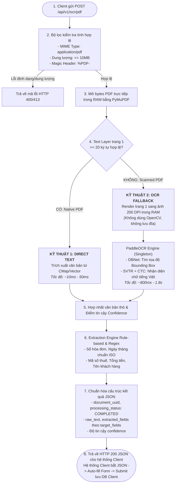

# TỔNG QUAN KIẾN TRÚC & KỸ THUẬT OCR SERVICE

Tài liệu này tinh gọn toàn bộ kiến trúc của **OCR Service**, tập trung vào **2 kỹ thuật cốt lõi**, **luồng xử lý tổng quát (Pipeline Flow)**, **bảng đánh giá hiệu năng & tài nguyên**, và **bảng tra cứu thuật ngữ kỹ thuật**.

---

## 1. Khái Niệm 2 Kỹ Thuật Cốt Lõi Áp Dụng

Hệ thống hoạt động theo mô hình **Hybrid (Lai ghép thông minh)**, kết hợp hài hòa giữa 2 kỹ thuật xử lý văn bản:

```
                      ┌────────────────────────────────────────┐
                      │             FILE PDF ĐẦU VÀO           │
                      └───────────────────┬────────────────────┘
                                          │
                   Kiểm tra Text Layer (Độ dài >= 20 ký tự)
                                         / \
                                       /     \
                       [Có sẵn Text] /         \ [Chỉ có ảnh / Quét]
                                   ▼             ▼
      ┌──────────────────────────────┐   ┌──────────────────────────────┐
      │   KỸ THUẬT 1: DIRECT TEXT    │   │      KỸ THUẬT 2: OCR         │
      │   Trích xuất từ Text Layer   │   │   Deep Learning (PaddleOCR)  │
      │        (PyMuPDF / MuPDF)     │   │      (DBNet + SVTR/CTC)      │
      └──────────────────────────────┘   └──────────────────────────────┘
```

### 1.1. Kỹ Thuật 1: Trích Xuất Văn Bản Trực Tiếp (Direct Text Extraction qua PyMuPDF)
- **Khái niệm**: Là kỹ thuật đọc và giải mã trực tiếp các đối tượng văn bản số hóa (Font descriptors, bảng mã `ToUnicode CMap` và luồng chỉ lệnh `TJ`/`Tj`) đã được nhúng sẵn bên trong cấu trúc vector của file **PDF Điện tử (Native/Digital PDF)**.
- **Cách thức hoạt động**:
  - Khi PDF được tạo từ các phần mềm văn phòng (Word, Excel) hoặc hệ thống hóa đơn điện tử (MISA, VNPT, Viettel...), các ký tự chữ đã tồn tại sẵn dưới dạng mã hóa nhị phân.
  - Sử dụng thư viện **PyMuPDF** (nhân C++ MuPDF tốc độ cao) đọc trực tiếp luồng bytes trong RAM (In-Memory) mà không cần lưu file tạm ra ổ đĩa.
  - Trích xuất toàn bộ chuỗi ký tự với độ chính xác tuyệt đối mà không cần can thiệp bất kỳ mô hình AI/thị giác máy tính nào.
- **Ưu điểm**:
  - Tốc độ cực nhanh (chỉ từ 5ms – 30ms).
  - Tiêu tốn CPU và RAM ở mức tối thiểu (< 1% CPU).
  - Độ chính xác đạt 100%, không bị nhận diện nhầm ký tự như các mô hình AI.

---

### 1.2. Kỹ Thuật 2: Nhận Dạng Ký Tự Quang Học Học Sâu (Deep Learning OCR qua PaddleOCR Fallback)
- **Khái niệm**: Là kỹ thuật sử dụng thị giác máy tính và các mạng nơ-ron tích chập (Convolutional Neural Networks) để phân tích từng điểm ảnh (pixel) trên tài liệu dạng ảnh hoặc **PDF Scan (Scanned/Image PDF)**, từ đó phát hiện và chuyển đổi hình ảnh chữ viết thành văn bản số hóa.
- **Cách thức hoạt động**:
  - Chỉ được kích hoạt dưới dạng **cơ chế dự phòng (Fallback)** khi Kỹ thuật 1 xác định tài liệu không có text layer hoặc text layer quá ngắn/vô nghĩa (< 20 ký tự).
  - Trang PDF được chuyển đổi (Rasterization) trực tiếp trong RAM thành ma trận điểm ảnh độ phân giải chuẩn **200 DPI**.
  - Ảnh điểm được đưa qua pipeline 3 giai đoạn của **PaddleOCR (tiếng Việt)**:
    1. **Text Detection (DBNet)**: Mạng nơ-ron phân đoạn vi phân phát hiện chính xác tọa độ các hộp bao quanh dòng chữ (Bounding Boxes).
    2. **Direction Classification**: Mô hình CNN siêu nhẹ xác định hướng chữ và tự động xoay chuẩn nếu tài liệu bị ngược $180^\circ$.
    3. **Text Recognition (SVTR / CRNN + CTC)**: Trích xuất đặc trưng chuỗi thị giác và giải mã chuỗi ký tự tiếng Việt có dấu hoàn chỉnh.
- **Ưu điểm**:
  - Nhận diện tốt các tài liệu chụp ảnh, scan mờ, văn bản in bị cong lệch hoặc chất lượng kém.
  - Hỗ trợ đầy đủ bộ ký tự tiếng Việt có dấu Unicode.

---

## 2. Flow Tổng Quát Của Hệ Thống (Workflow Pipeline)

Quy trình xử lý hoàn chỉnh từ khi tiếp nhận file PDF đến khi bóc tách thông tin và ghi nhận an toàn vào cơ sở dữ liệu:



---

## 3. Bảng Đánh Giá Hiệu Năng & Tiêu Thụ Tài Nguyên

Bảng so sánh chi tiết giữa 2 kỹ thuật xử lý và phương pháp truyền thống:

| Tiêu Chí Đánh Giá | Kỹ Thuật 1: Direct Text (PyMuPDF) | Kỹ Thuật 2: Fallback OCR (PaddleOCR 200 DPI) | Phương Pháp Cũ (OpenCV tiền xử lý + Luôn chạy OCR) |
| :--- | :--- | :--- | :--- |
| **Thời gian phản hồi (Latency)** | **10ms – 50ms** *(Tức thì)* | **800ms – 1.800ms** *(Nhanh cho AI)* | **2.500ms – 5.000ms** *(Rất chậm)* |
| **Mức độ tiêu thụ CPU** | **< 1% CPU** (Gần như không tải) | **60% – 85% CPU** (Trong tích tắc tính tensor) | **100% CPU** (Nghẽn cổ chai liên tục) |
| **Dung lượng RAM chiếm dụng** | **~15 MB – 25 MB** | **~300 MB – 450 MB** (Giữ cố định qua Singleton) | **> 800 MB** (Dễ rò rỉ bộ nhớ do khởi tạo lại) |
| **Độ chính xác nội dung** | **100% Tuyệt đối** (Đọc từ mã số hóa gốc) | **95% – 98.5%** (Tùy chất lượng scan) | **88% – 93%** (Dễ mất nét do bộ lọc OpenCV quá đà) |
| **Tác vụ I/O Đĩa cứng** | **0 I/O** (Xử lý toàn bộ trong RAM) | **0 I/O** (Rasterize trực tiếp sang NumPy RAM) | Cao (Lưu file ảnh tạm thời ra ổ cứng) |
| **Khả năng chịu tải (Concurrency)** | Rất cao (> 150 request/giây/core) | Trung bình (5 – 15 request/giây/core) | Rất thấp (Dễ treo máy khi có nhiều người dùng) |
| **Trường hợp áp dụng thực tế** | Hóa đơn điện tử, văn bản từ Word/Excel/GDocs | Giấy tờ scan, chụp ảnh hóa đơn giấy, chứng từ in | *Không khuyến nghị sử dụng* |

---

## 4. Bảng Tra Cứu Tổng Quát Các Thuật Ngữ Kỹ Thuật (Technical Glossary)

| Thuật Ngữ | Tên Tiếng Anh / Viết Tắt | Giải Thích Bản Chất & Vai Trò Trong Hệ Thống |
| :--- | :--- | :--- |
| **PDF Điện tử** | *Native / Digital PDF* | File PDF được tạo trực tiếp từ phần mềm vi tính. Bên trong chứa sẵn các đối tượng font chữ và chuỗi ký tự số hóa (Text Layer), người dùng có thể bôi đen copy được. |
| **PDF Scan / Ảnh** | *Scanned / Image PDF* | File PDF bản chất chỉ là 1 bức ảnh chụp (pixel) được đóng gói trong vỏ bọc PDF. Không có chữ số hóa sẵn, máy tính không thể copy chữ nếu không dùng OCR. |
| **Lớp Văn Bản** | *Text Layer* | Lớp dữ liệu vector chứa thông tin ký tự số hóa và tọa độ hiển thị được nhúng bên trong file PDF. |
| **Nhận Dạng Ký Tự Quang Học** | *Optical Character Recognition (OCR)* | Công nghệ thị giác máy tính giúp chuyển đổi hình ảnh chứa chữ viết (bản in hoặc chữ viết tay) thành văn bản mà máy tính có thể đọc và chỉnh sửa được. |
| **Mạng Dò Chữ DBNet** | *Real-time Scene Text Detection with Differentiable Binarization* | Mạng nơ-ron học sâu làm nhiệm vụ dò tìm và khoanh vùng chính xác tọa độ các khối/dòng chữ trong ảnh thông qua thuật toán nhị phân hóa vi phân. |
| **Mô Hình Nhận Diện SVTR / CRNN** | *Scene Text Recognition / Convolutional Recurrent Neural Network* | Mạng nơ-ron nhận diện ảnh dòng chữ đã cắt, kết hợp tích chập trích xuất đặc trưng và lớp hồi quy (LSTM) để đọc ngữ cảnh các ký tự. |
| **Giải Mã Ký Tự CTC** | *Connectionist Temporal Classification* | Thuật toán giải mã chuỗi dự đoán từ mạng nơ-ron thành văn bản cuối cùng mà không cần gán nhãn từng vị trí pixel của từng chữ cái. |
| **Khung Bao Dòng Chữ** | *Bounding Box (BBox)* | Tọa độ 4 đỉnh đa giác $[(x_1, y_1), (x_2, y_2), (x_3, y_3), (x_4, y_4)]$ xác định vị trí của một dòng chữ trên bề mặt tài liệu. |
| **Xử Lý Trong Bộ Nhớ** | *In-Memory Processing* | Kỹ thuật đọc, render và xử lý dữ liệu hoàn toàn trên bộ nhớ RAM (sử dụng `fitz.open(stream=...)` và buffer mảng đa chiều NumPy), không sinh file tạm ra ổ đĩa, giúp bảo mật và tối đa hóa tốc độ. |
| **Độ Phân Giải DPI** | *Dots Per Inch (200 DPI)* | Mật độ điểm ảnh khi chuyển trang PDF sang ảnh. 200 DPI là ngưỡng cân bằng tối ưu giữa kích thước ảnh nhỏ nhẹ và độ sắc nét cao để OCR nhận diện chuẩn xác. |
| **Khởi Tạo Trước & Mẫu Singleton** | *Lifespan Pre-warming & Singleton Pattern* | Cơ chế nạp sẵn trọng số mô hình Deep Learning vào RAM ngay khi hệ thống khởi động và tái sử dụng 1 đối tượng duy nhất, tránh tình trạng load lại mô hình gây đơ server ở mỗi request. |
| **Bóc Tách Dựa Trên Quy Tắc** | *Rule-based & Regex Extraction* | Thuật toán bóc tách trường thông tin (Số HĐ, MST, Ngày, Tiền) bằng mẫu biểu thức chính quy (Regex) và từ khóa neo, đảm bảo tốc độ tức thì (~1ms) và loại bỏ hoàn toàn rủi ro sai lệch của LLM. |
| **Giao Dịch Cơ Sở Dữ Liệu** | *Database Transaction (ACID)* | Cơ chế quản lý dữ liệu an toàn theo nguyên tắc: Nếu lưu thông tin tài liệu (`documents`) và các trường chi tiết (`document_fields`) xảy ra lỗi ở bất kỳ bước nào thì toàn bộ thao tác sẽ được hủy bỏ (`Rollback`), đảm bảo không có dữ liệu rác. |
