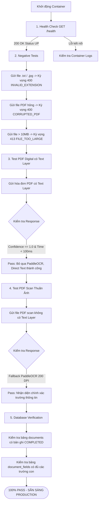

# QUY TRÌNH KIỂM THỬ TOÀN DIỆN (TEST FLOW)

Tài liệu này mô tả chi tiết quy trình kiểm thử từ đầu đến cuối (End-to-End Test Flow) cho **OCR Service** và Model nhằm đảm bảo tính ổn định, tốc độ và độ chính xác trước khi đưa vào môi trường Production.

---

## 1. Sơ Đồ Quy Trình (Mermaid Workflow)



---

## 2. Các Bước Thực Hiện Kiểm Thử

### Bước 1: Kiểm tra trạng thái dịch vụ (Health Check)
- **Mục đích**: Xác định server FastAPI và singleton PaddleOCR đã được khởi tạo và sẵn sàng nhận request.
- **Lệnh thực hiện**:
  ```bash
  curl http://localhost:8000/health
  ```
- **Kỳ vọng**: HTTP `200 OK`, JSON `{"status": "UP"}`.

---

### Bước 2: Kiểm thử xác thực đầu vào (Negative Validation Tests)
- **Mục đích**: Đảm bảo service từ chối các file không hợp lệ, không làm treo hoặc crash server.
- **Kịch bản**:
  1. **Sai đuôi file**: Gửi file `data.txt` hoặc `image.png` -> Nhận lỗi `400 Bad Request` kèm mã `INVALID_EXTENSION`.
  2. **File PDF hỏng (Corrupt)**: File có đuôi `.pdf` nhưng nội dung không có header nhị phân `%PDF-` -> Nhận lỗi `400 Bad Request` kèm mã `CORRUPTED_PDF`.
  3. **File quá dung lượng**: File dung lượng > 10MB -> Nhận lỗi `413 Request Entity Too Large` kèm mã `FILE_TOO_LARGE`.

---

### Bước 3: Kiểm thử PDF Digital (Direct Text Extraction)
- **Mục đích**: Xác minh tài liệu điện tử (hóa đơn MISA, VNPT, file xuất từ Word) được đọc trực tiếp bằng **PyMuPDF**, tuyệt đối **không chạy PaddleOCR**.
- **Kỳ vọng**:
  - Thời gian xử lý: `< 100ms`.
  - Độ tin cậy (`confidence`): `1.0`.
  - Các trường bóc tách: Số hóa đơn, ngày tháng, mã số thuế, số tiền, tên người mua chính xác 100%.

---

### Bước 4: Kiểm thử PDF Scan (Fallback PaddleOCR 200 DPI)
- **Mục đích**: Xác minh khi gặp tài liệu giấy quét thành ảnh (không có text layer), hệ thống tự động kích hoạt **PaddleOCR** với độ phân giải **200 DPI**.
- **Kỳ vọng**:
  - Tự động fallback mượt mà, không sinh exception.
  - Nhận diện chuẩn xác nội dung tiếng Việt.
  - Phản hồi HTTP `200 OK`, `processing_status: "COMPLETED"`.

---

### Bước 5: Kiểm tra tính toàn vẹn Cơ sở dữ liệu (Database Transaction)
- **Mục đích**: Đảm bảo dữ liệu được lưu an toàn theo cơ chế Transaction (bảng cha `documents` và bảng con `document_fields`).
- **Lệnh kiểm tra trong MySQL**:
  ```sql
  -- Kiểm tra tài liệu mới nhất
  SELECT id, document_uuid, original_filename, ocr_engine, processing_status, created_at 
  FROM documents 
  ORDER BY id DESC LIMIT 5;

  -- Kiểm tra các trường dữ liệu con tương ứng
  SELECT document_id, field_name, field_value, confidence 
  FROM document_fields 
  WHERE document_id = (SELECT MAX(id) FROM documents);
  ```

---

## 3. Hướng Dẫn Chạy Script Test Tự Động

Chúng tôi đã chuẩn bị sẵn file script tự động [scripts/run_flow_test.py](file:///e:/ocr-service/scripts/run_flow_test.py). Script này sẽ tự động giả lập cả 4 bước kiểm thử và in ra báo cáo trực quan.

### Cách 1: Chạy trực tiếp qua Docker container (Khuyên dùng)
```bash
docker run --rm \
  --network host \
  -v "${PWD}:/app" \
  ocr-service:latest \
  python /app/scripts/run_flow_test.py
```

### Cách 2: Chạy trên máy host (Nếu đã cài môi trường)
```bash
python scripts/run_flow_test.py
```
